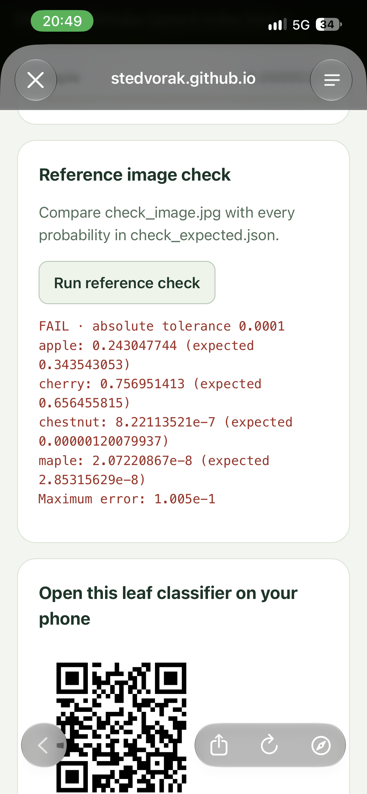

# MLR Exercise 08 — Experimental report (Task 4)

Repository: https://github.com/Stedvorak/mlr-ex08  
Experiment notebook: `task4/Task4_Colab.ipynb`  
Detailed results: `task4/results.csv`, `task4/summary.csv`, `task4/paired_comparisons.csv`, `task4/comparison.png`

## Objective and methodology

The goal was to compare model/training variants for leaf classification, including performance on the original validation images and on a camera-like evaluation set, and to select a practical candidate for mobile inference. The Colab run contains **27 completed experiments**: nine variants B0 and E1–E8, each with three seeds (0, 1, 2) and 15 training epochs. The `task4/summary.csv` values below are means and sample standard deviations across seeds. `E9` is recorded as `not_run`; no result is claimed for it.

Original and camera-like evaluation scores are **different test conditions**, not interchangeable estimates of real-world phone accuracy. Because the validation set is small (62 images in the candidate verification), differences of a few percentage points can reflect only a few samples. The three-seed spread and paired comparisons help distinguish robust effects from noise; they do not establish statistical significance by themselves.

## Results across all completed variants

| Variant | Runs | Original validation accuracy (mean ± SD) | Camera-like accuracy (mean ± SD) | Mean training time (s) |
| --- | ---: | ---: | ---: | ---: |
| B0 | 3 | 67.74% ± 5.82 pp | 40.32% ± 7.39 pp | 4.22 |
| E1 | 3 | 70.97% ± 1.61 pp | 47.31% ± 6.11 pp | 9.39 |
| E2 | 3 | 67.74% ± 3.23 pp | 49.46% ± 1.86 pp | 3.72 |
| E3 | 3 | 67.20% ± 2.46 pp | 41.94% ± 8.38 pp | 4.13 |
| E4 | 3 | 65.05% ± 5.66 pp | 42.47% ± 1.86 pp | 3.66 |
| **E5** | **3** | **82.26% ± 1.61 pp** | **84.95% ± 0.93 pp** | **3.60** |
| E6 | 3 | 75.27% ± 6.11 pp | 70.97% ± 11.29 pp | 5.84 |
| E7 | 3 | 77.42% ± 0.00 pp | 77.96% ± 10.24 pp | 13.76 |
| E8 | 3 | 77.42% ± 4.27 pp | 72.58% ± 7.03 pp | 5.72 |

*SD is shown in percentage points (pp); values are rounded from `task4/summary.csv`.*

## Which changes helped?

E5, the **pretrained frozen MobileNetV3 Small candidate**, had the highest average accuracy on both original and camera-like validation. Relative to B0, its mean score was higher by approximately **14.52 percentage points** on original validation and **44.62 percentage points** on camera-like evaluation. It also had low across-seed variability (1.61 and 0.93 pp respectively). This is the clearest practical improvement in the completed experiment suite.

The matched-seed comparison of **E5 against E6** showed mean gains of **+6.99 pp** on original validation and **+13.98 pp** on camera-like evaluation, with paired SD of **6.52 pp** and **10.49 pp**. This favors E5 in the observed runs, while the spread cautions against interpreting the precise difference as universal.

E6 improved substantially over B0 on camera-like evaluation (**+30.65 pp** paired mean), but its variability was larger and its mean accuracy remained below E5. E7 and E8 were competitive on original validation but did not exceed E5 on camera-like evaluation.

## Which changes did not help, or were inconclusive?

E1 gave a modest average improvement over B0 (+3.23 pp original, +6.99 pp camera-like in matched-seed comparisons), but not enough to challenge E5. E2 was effectively unchanged on original validation (0 pp paired mean) and improved camera-like accuracy by about 9.14 pp. E3 slightly reduced original validation accuracy and had only a small camera-like gain. E4 reduced original validation accuracy by about 2.69 pp versus B0. E7 versus E6 improved original validation by only about 2.15 pp and camera-like by 6.99 pp, with a **20.80 pp paired SD** on the camera-like difference: the apparent gain is highly variable. E8 versus E6 yielded small average gains (+2.15 pp original, +1.61 pp camera-like), not a convincing improvement.

The experiment labels and numerical comparisons above follow the published CSVs. For exact architectural, augmentation and optimizer settings associated with each E-label, the authoritative source is `task4/Task4_Colab.ipynb`; this report does not infer settings from labels alone.

## Chosen mobile model and verification

**Recommendation: deploy/test E5**, not the weaker baseline. The candidate `task4/candidate_leaf_model.onnx` was exported from **E5 seed 1**, with corresponding `task4/model_info.json`. The published verification reproduced **51/62 correct** original validation predictions and reports **53/62** on camera-like validation for this seed. The Colab PyTorch-to-ONNX parity report records **124/124 matching predictions** and maximum probability difference **0.00000602007**. These are verification results for the candidate, not proof of universal robustness.

The candidate was also tested through the separate `e5/` phone page: an uploaded maple-leaf photo was classified as maple with **89.313267%** probability and **54 ms** displayed inference time. This demonstrates basic mobile feasibility, but a single image and timing measurement do not establish average accuracy, latency distribution, or battery usage.

The original root web app and `leaf_model.onnx` were kept separate from the E5 candidate, so Task 2's original classifier was not silently replaced. The original Task 2 Safari JPEG reference mismatch was diagnosed independently and is documented in `REVIEW.md`.

## Limitations and conclusion

The validation sample is limited; three seeds do not justify strong statistical claims; camera-like transformations are not the same as an independent real-world phone dataset. The notebook and published CSVs are the reproducible numerical record; original private photographs and full per-epoch training artifacts were not published in the Task 4 bundle. Nevertheless, the completed experiments consistently favor E5, which combines the best observed mean validation results, low seed-to-seed variation, successful ONNX export verification, and a working phone-page example. **E5 is the recommended candidate for mobile deployment.**

## Mobile screenshots

The E5 candidate was tested on iPhone Safari with a maple-leaf photograph. The model predicted **maple (89.313267%)**, with **54 ms** displayed for that single prediction. This is not a representative performance benchmark.

The original Task 2 JPEG reference check failed on Safari, while the separate PNG diagnostic passed on Safari and Chrome. The root page was not verified as switched to PNG.

