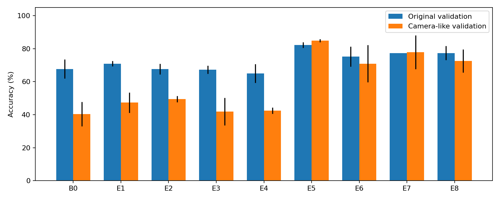
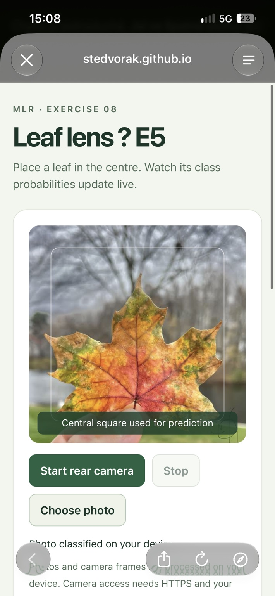
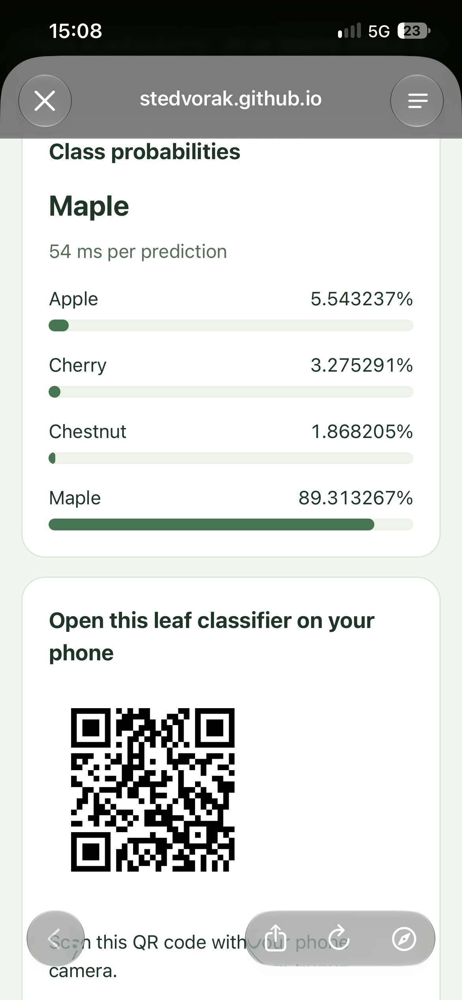
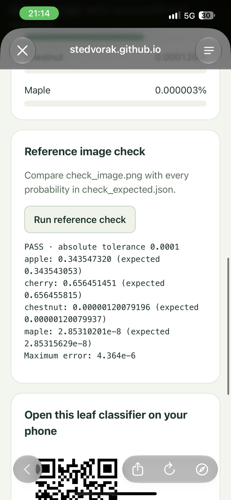

# MLR Exercise 08 — Experimental report (Task 4)

Repository: https://github.com/Stedvorak/mlr-ex08  
Notebook: `task4/Task4_Colab.ipynb`  
Data: `task4/results.csv`, `task4/summary.csv`, `task4/paired_comparisons.csv`, `task4/comparison.png`

## Objective and experimental design

The aim was to compare leaf-classification training/model variants on the original validation images and camera-like evaluation, then select a practical candidate for mobile inference. The completed Colab run contains **27 experiments**: B0 and E1–E8, three random seeds (0, 1, 2) per variant, and 15 epochs per run. E9 is explicitly marked `not_run`. Means and sample standard deviations below are calculated across the three seeds.

Camera-like evaluation is a transformed evaluation condition, **not** an independent real-world phone test. The validation sample is small (62 images for the candidate verification), so a few percentage points can correspond to only a few images. Three seeds give a useful indication of variability but do not prove statistical significance.

## Results

| Variant | Runs | Original validation accuracy (mean ± SD) | Camera-like accuracy (mean ± SD) | Mean training time (s) |
| --- | ---: | ---: | ---: | ---: |
| B0 | 3 | 67.74% ± 5.82 pp | 40.32% ± 7.39 pp | 4.22 |
| E1 | 3 | 70.97% ± 1.61 pp | 47.31% ± 6.11 pp | 9.39 |
| E2 | 3 | 67.74% ± 3.23 pp | 49.46% ± 1.86 pp | 3.72 |
| E3 | 3 | 67.20% ± 2.46 pp | 41.94% ± 8.38 pp | 4.13 |
| E4 | 3 | 65.05% ± 5.66 pp | 42.47% ± 1.86 pp | 3.66 |
| **E5** | **3** | **82.26% ± 1.61 pp** | **84.95% ± 0.93 pp** | **3.60** |
| E6 | 3 | 75.27% ± 6.11 pp | 70.97% ± 11.29 pp | 5.84 |
| E7 | 3 | 77.42% ± 0.00 pp | 77.96% ± 10.24 pp | 13.76 |
| E8 | 3 | 77.42% ± 4.27 pp | 72.58% ± 7.03 pp | 5.72 |

*SD values are percentage points (pp). Data are rounded from `task4/summary.csv`.*

## Which changes helped?

**E5 (pretrained frozen MobileNetV3 Small)** was the strongest candidate, reaching the highest mean accuracy on both evaluation conditions. Compared with B0, E5 improved original validation accuracy by **14.52 pp** and camera-like accuracy by **44.62 pp**. It also showed low seed-to-seed variation: 1.61 pp and 0.93 pp respectively.

In matched-seed comparisons, E5 exceeded E6 by an average of **6.99 pp** on original validation and **13.98 pp** on camera-like evaluation (paired SD 6.52 and 10.49 pp). E6 also improved substantially over B0 on camera-like data (+30.65 pp in matched-seed comparisons), but its performance varied more between seeds and remained below E5.

E7 and E8 were competitive on the original validation set but did not surpass E5 on camera-like evaluation.

## Which changes did not help, or were inconclusive?

E1 offered modest matched-seed gains over B0 (+3.23 pp original, +6.99 pp camera-like). E2 was unchanged on original validation (0 pp paired mean) and improved camera-like accuracy by about 9.14 pp. E3 slightly decreased original validation accuracy, with only a small camera-like gain. E4 decreased original validation accuracy by about 2.69 pp versus B0.

E7 versus E6 showed only a small original-validation improvement (+2.15 pp) and a camera-like gain of +6.99 pp with a large **20.80 pp paired SD**. E8 versus E6 showed modest average changes (+2.15 pp original and +1.61 pp camera-like). These are not persuasive improvements over the best E5 configuration.

Exact architectural, augmentation and optimizer configurations for each E-label are defined in `task4/Task4_Colab.ipynb`; the labels alone should not be interpreted as evidence of particular changes.

## Selected model and deployment decision

**E5 is the recommended mobile candidate.** The exported `task4/candidate_leaf_model.onnx` corresponds to E5 seed 1, with matching `task4/model_info.json`. Candidate verification reported **51/62** correct original-validation predictions and **53/62** correct camera-like predictions. PyTorch/ONNX export parity recorded **124/124** matching predicted classes and maximum probability difference **6.02007e-6**.

The candidate was separately deployed at https://stedvorak.github.io/mlr-ex08/e5/ and tested on iPhone Safari. An uploaded maple-leaf image was classified as **maple with 89.313267% probability**; displayed inference time was **54 ms**. This supports functional mobile feasibility, not a claim of average phone accuracy or latency.

The original root `leaf_model.onnx` remains separate from the E5 candidate. Its reference check was subsequently made cross-browser reproducible by replacing the JPEG *reference input* with a lossless PNG; neither the original model nor the expected probabilities were changed. The production PNG reference check on iPhone Safari passed on 15 November 2026, with maximum error **4.364e-6** and a single displayed inference time of **42 ms**. See `REVIEW.md` for details.

## Limitations and conclusion

The experiment suite used only three seeds and a small validation sample. Camera-like transformations cannot substitute for an independent real-world mobile dataset. Training images and full per-epoch artifacts are not included in the published Task 4 bundle; the notebook and CSVs are the numerical record.

The results consistently favor E5: highest mean validation performance, relatively low seed variability, successful ONNX verification, and a working mobile example. **Deploy E5 as the preferred candidate**, while treating the single phone test as a functionality check rather than a performance benchmark.

## Mobile evidence

