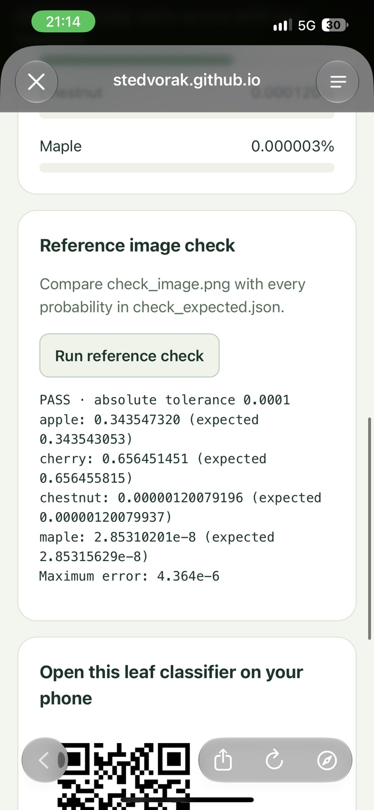
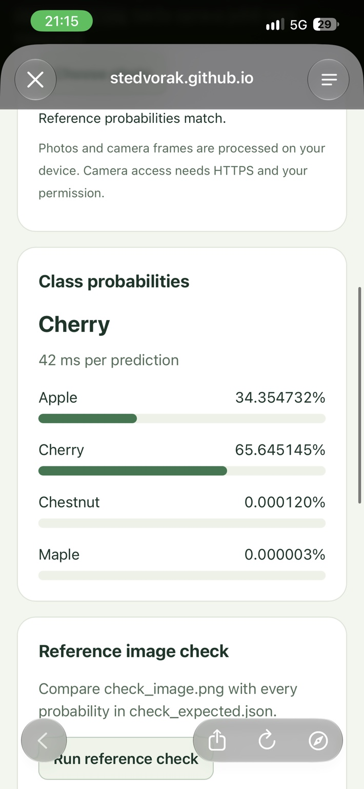
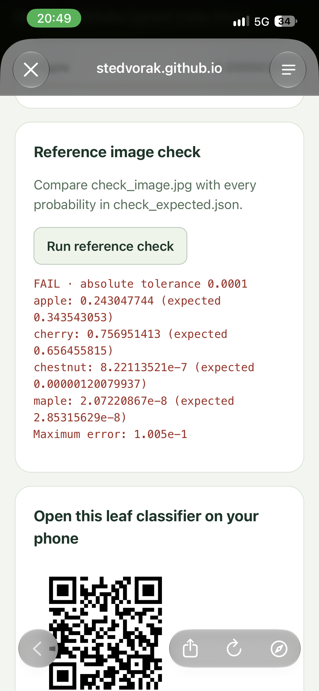
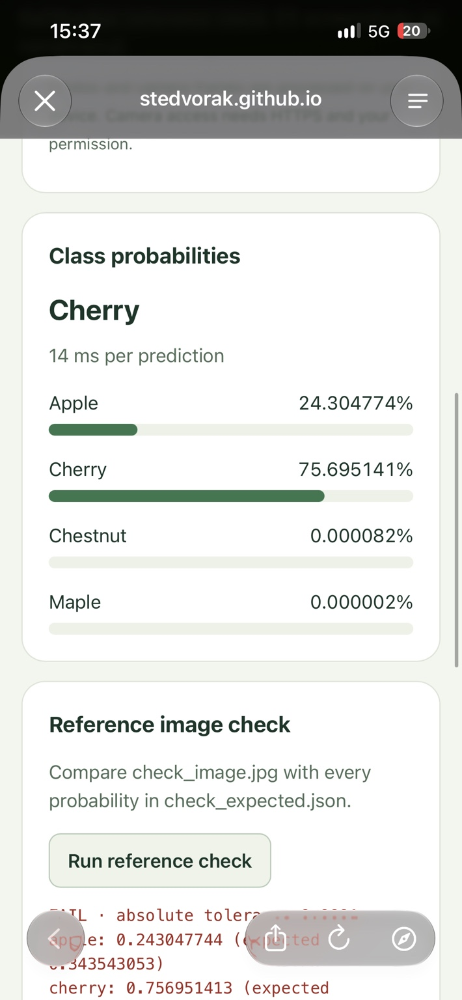
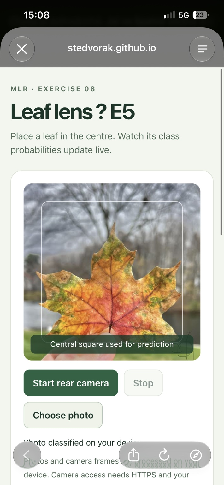
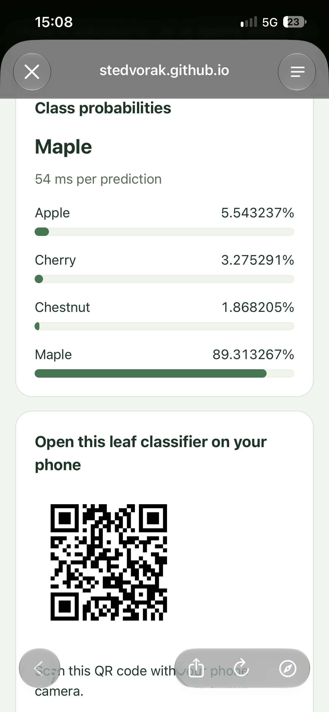

# MLR Exercise 08 — Code and mobile review

Repository: https://github.com/Stedvorak/mlr-ex08  
Production application: https://stedvorak.github.io/mlr-ex08/  
E5 candidate: https://stedvorak.github.io/mlr-ex08/e5/

## Task 2 — Implementation review

The static HTML/JavaScript application loads `leaf_model.onnx` and `model_info.json` into ONNX Runtime Web 1.20.1 (single-threaded WASM). Inference is performed locally in the browser. The interface includes rear-camera access, photo upload, all four class probabilities (apple, cherry, chestnut, maple), prediction time, a QR code, and a numerical reference check.

The common `preprocess()` path centrally crops the image to a square, resizes it to 96 × 96, converts RGB channels to `[0,1]`, standardizes with the mean/std from `model_info.json`, and constructs a float32 NCHW tensor `[1,3,96,96]`. Model logits are converted to probabilities with stable softmax. Inference requests are serialized to avoid overlap. Camera access requires HTTPS; uploading a photo is the fallback.

| Requirement | Finding | Evidence / caveat |
| --- | --- | --- |
| Public mobile page | Implemented | GitHub Pages URL above |
| Browser-based ONNX inference | Implemented | `index.html`, ONNX Runtime Web / WASM |
| Correct input preprocessing | Implemented | Shared `preprocess()` for video, upload and reference |
| Four class probabilities | Implemented | All class values and progress bars |
| Rear camera / photo upload | Implemented | `getUserMedia`, file input; continuous camera performance not benchmarked |
| Public link / QR code | Implemented | Footer of production page |
| Reference image check | **PASS on iPhone Safari after PNG fix** | Production page screenshot below; tolerance `0.0001` |
| Model metadata | Consistent | Class order and preprocessing specified in `model_info.json` |

## Cross-browser reference debugging and final fix

The original `check_image.jpg` decoded differently in Windows Chrome and iPhone Safari. The mismatch occurred in canvas RGBA pixels *before* ONNX inference. For example, pixel 4096 was `[162,162,150,255]` in Chrome and `[164,161,154,255]` in Safari. A lossless `check_image.png` was generated from the Chrome-verified reference pixels. The original JPEG, ONNX model, and `check_expected.json` were retained.

| Reference / browser | RGBA hash | Tensor hash | Apple probability | Cherry probability | Max. abs. error | Result |
| --- | --- | --- | ---: | ---: | ---: | --- |
| JPEG / Windows Chrome | `eeb06748` | `3d21aad1` | 0.343547320 | 0.656451451 | 0.000004364 | PASS |
| JPEG / iPhone Safari | `c45e9ef4` | `f6171ff8` | 0.243047744 | 0.756951413 | 0.100495598 | FAIL |
| PNG / Windows Chrome | `eeb06748` | `3d21aad1` | 0.343547320 | 0.656451451 | 0.000004364 | PASS |
| PNG / iPhone Safari | `eeb06748` | `3d21aad1` | 0.343547320 | 0.656451451 | 0.000004364 | PASS |

The expected probabilities are stored in `check_expected.json`; the absolute tolerance is `0.0001`. Both separate PNG diagnostics returned `rgbaMatchesChrome: true`, `tensorMatchesChrome: true`, `numericalPass: true`, and `pass: true`.

**Final production retest (15 November 2026):** The root `index.html` was updated to use `check_image.png` for its reference check. The production page on iPhone Safari explicitly displayed `Compare check_image.png`, `PASS`, and **maximum error `4.364e-6`**. It showed apple `0.343547320`, cherry `0.656451451`, chestnut `0.00000120079196`, and maple `2.85310201e-8`. The same screen displayed **42 ms per prediction** for this single reference run. The PNG fix therefore passed on the production page, not just the separate diagnostic page. No claim of statistically representative mobile speed is made.

## Task 4 — Candidate phone test

The separate E5 page was tested on iPhone Safari with an uploaded maple leaf photo. It predicted **maple at 89.313267%**, with **54 ms** displayed for that one inference. This is a functional check, not a representative accuracy or latency benchmark. The E5 candidate remains separate from the original Task 2 classifier.

## Screenshots

### Production PNG reference check — PASS on iPhone Safari

### Earlier JPEG issue — FAIL on iPhone Safari

### E5 candidate mobile test

## Conclusion

The original leaf classifier is publicly available and its production PNG reference check now **passes on iPhone Safari**. The previous JPEG mismatch was traced to browser-dependent decoded pixels, and the PNG replacement resolved it without changing the model or expected values. The separate E5 candidate was also successfully exercised on an uploaded phone photo. Broader real-world performance remains unmeasured.
